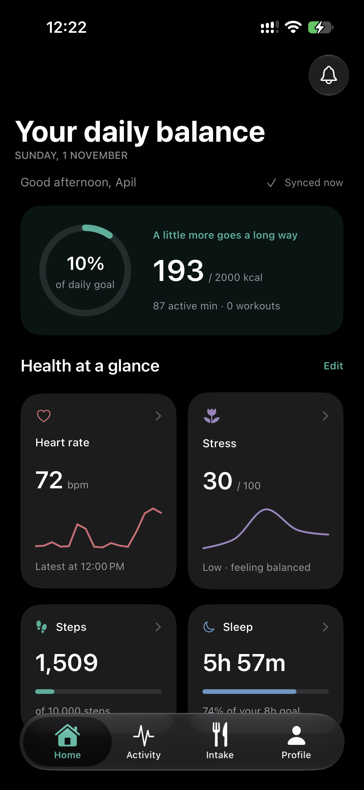
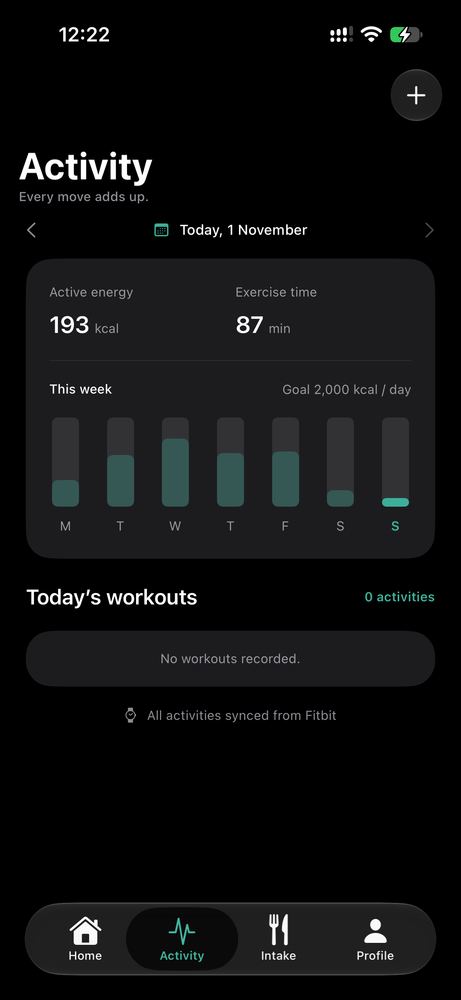
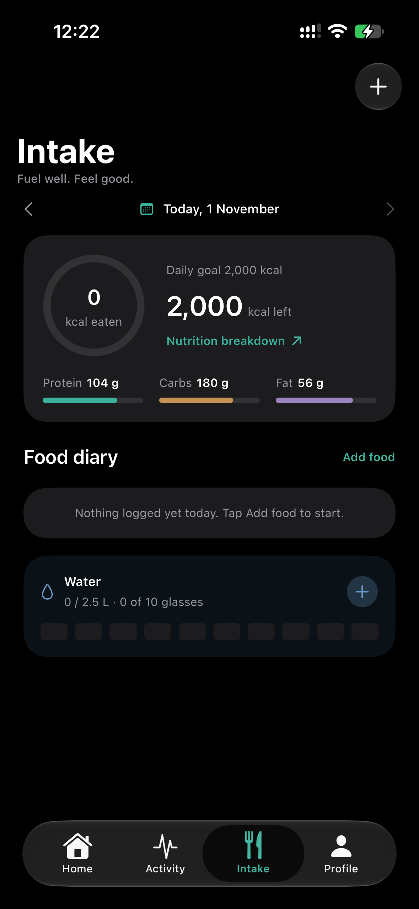
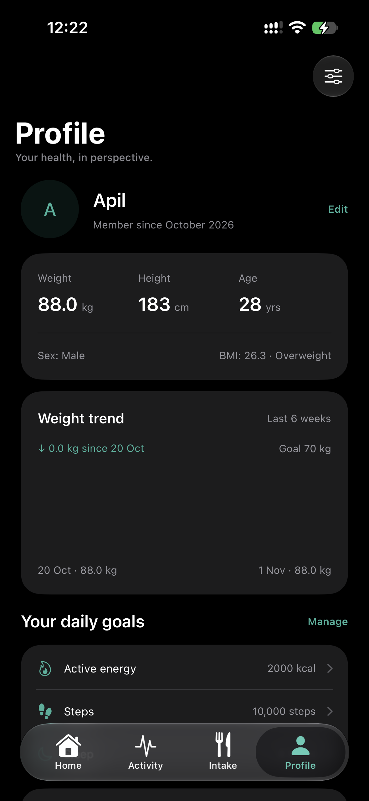
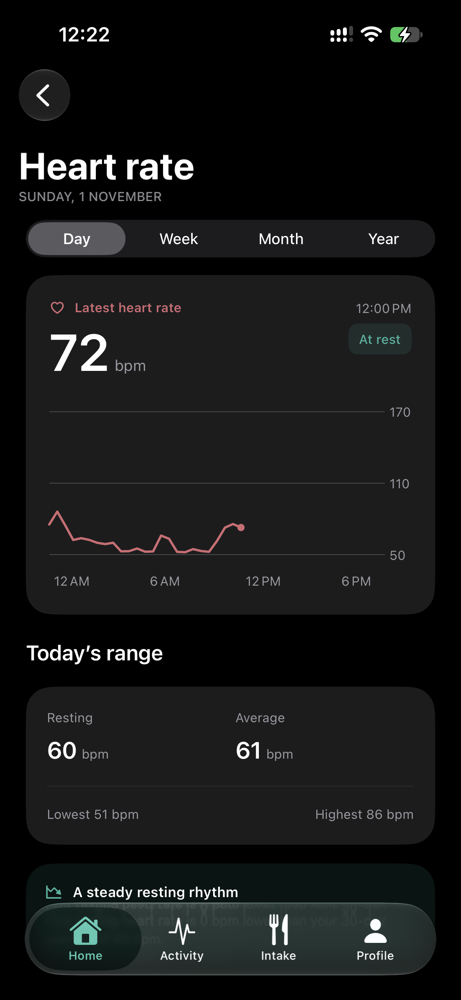
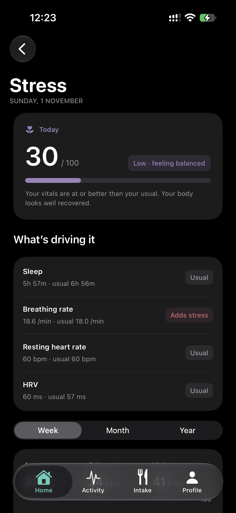
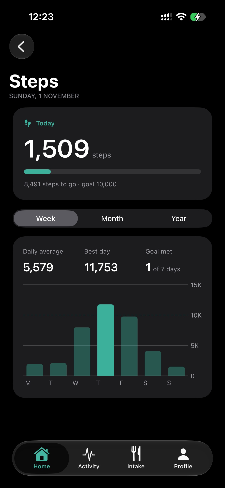
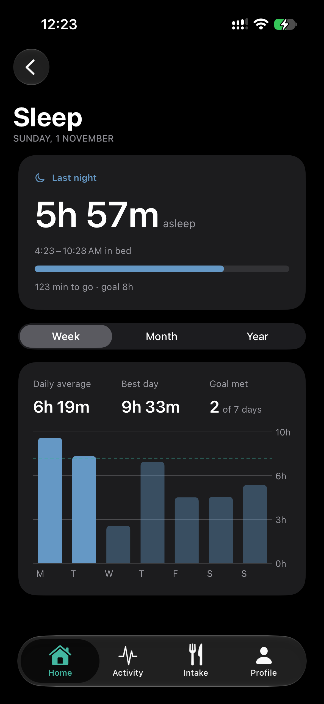

# Health Tracker

An iOS app for your Fitbit data. It syncs steps, sleep, heart rate, workouts and overnight vitals from the
[Google Health API](https://developers.google.com/health), and lets you log meals, water and workouts yourself.
Built with SwiftUI from a set of Figma designs.

## Screens

| Home | Activity | Intake | Profile |
|:---:|:---:|:---:|:---:|
|  |  |  |  |

| Heart rate | Stress | Steps | Sleep |
|:---:|:---:|:---:|:---:|
|  |  |  |  |

## Features

- **Daily overview**: active energy against your goal, plus heart rate, stress, steps and sleep at a glance.
- **Trends**: week, month and year charts for steps, sleep and resting heart rate (up to a year of history).
- **Stress estimate**: Fitbit devices without a stress sensor still record overnight HRV, resting heart rate,
  sleep, breathing rate and skin temperature. The app compares each night with your previous 30 days and turns
  the difference into a 0–100 score, showing which signal is driving it. It's an estimate, not a medical measurement.
- **Activity and intake**: browse any past day, log workouts, meals and water.
- **Profile and goals**: edit your details and daily goals. Everything you enter is saved on the device.
- Without a Google account connected, the app runs on sample data.

## Project layout

```
MyApp/
  Models/     Plain data types
  Data/       HealthStore (app state), local storage, Google Health client
  Domain/     Rules, calculations and copy (stress score, trends, BMI, insights)
  UI/         Theme and shared SwiftUI components
  Features/   One folder per tab: Home, Activity, Intake, Profile
Checks/       Runnable checks for the non-UI layers
```

`Models`, `Data` and `Domain` use only Foundation, so they can be ported to Flutter or React Native
without untangling UI code. Only `UI` and `Features` import SwiftUI.

## Running

1. Open `MyApp.xcodeproj` in Xcode and set your own team under *Signing & Capabilities*.
2. Run on an iPhone (iOS 27+).

### Connecting Google Health

The app uses OAuth with PKCE (no client secret). To use your own Google Cloud project:

1. Enable the **Google Health API** and create an **iOS** OAuth client for your bundle ID.
2. Put the client ID and its reversed form (`com.googleusercontent.apps.<id>`) in
   `MyApp/Data/GoogleHealth/GoogleAuth.swift`.
3. Keep the consent screen in *Testing* and add yourself as a test user. That's free for up to 100 users,
   but sign-in expires every 7 days.
4. In the app, go to **Profile → Google Health → Connect**.

### Checks

```sh
xcrun swiftc -swift-version 5 MyApp/Models/*.swift MyApp/Data/*.swift MyApp/Data/GoogleHealth/*.swift \
  MyApp/Domain/*.swift Checks/main.swift -o /tmp/checks && /tmp/checks
```

### Screenshots

Launch with `-screen <name>` (`home`, `activity`, `intake`, `profile`, `heart`, `stress`, `steps`, `sleep`)
to open a screen directly.
